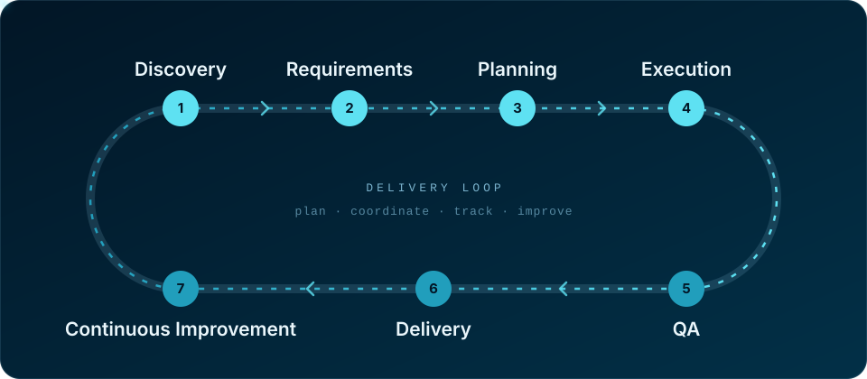

<picture>
  <source media="(prefers-color-scheme: dark)" srcset="./assets/banner-dark.svg" />
  <source media="(prefers-color-scheme: light)" srcset="./assets/banner-light.svg" />
  
</picture>

<h3>Bridging Business Requirements, Technology &amp; Project Delivery.</h3>

<b>SOFTWARE PROJECT MANAGEMENT</b> &nbsp;|&nbsp; PROJECT MANAGEMENT INTERN · SRI LANKA TELECOM

<b>OPEN TO</b> &nbsp;Internships · Graduate roles · Project coordination opportunities · Sri Lanka

 

## About me

I'm building my career in **software project management**. As a **Project Management Intern at Sri Lanka Telecom (SLT)**, I support the coordination of several enterprise and business software projects, working with technical teams to connect business expectations with development work.

My focus is the space between the business and the development team. I follow business and functional requirements, help organise them into trackable work, contribute to project documentation and reporting, and follow up on progress and issues until they're resolved.

The software is built by SLT's development teams. My contribution is on the **project management side**: planning, coordination, requirements and documentation, backed by a working understanding of the software development lifecycle.

<table>
  <tr>
    <td><b>Current role</b></td>
    <td>Project Management Intern · Sri Lanka Telecom · Apr 2026 – Mar 2027 (expected)</td>
  </tr>
  <tr>
    <td><b>Focus</b></td>
    <td>Software project management · Requirements &amp; documentation · Delivery coordination</td>
  </tr>
  <tr>
    <td><b>Education</b></td>
    <td>BSc (Hons) IT for Business, Coventry University <i>(in progress, third year)</i> · Diploma in IT, ESOFT</td>
  </tr>
  <tr>
    <td><b>Certification</b></td>
    <td>Oracle Project Management Certification <i>(in progress)</i></td>
  </tr>
</table>

 

## What I do

<table>
  <tr>
    <td width="50%" valign="top">
       
      <b>Project Planning &amp; Coordination</b> 
      Supporting project planning, organising tasks and following up so work keeps moving across several concurrent projects.
    </td>
    <td width="50%" valign="top">
       
      <b>Requirements Management</b> 
      Following business and functional requirements as they're refined, and mapping user journeys and system workflows.
    </td>
  </tr>
  <tr>
    <td valign="top">
       
      <b>Project Documentation &amp; Reporting</b> 
      Contributing to project documentation and status reporting, so requirements and decisions stay traceable.
    </td>
    <td valign="top">
       
      <b>Team Collaboration</b> 
      Day-to-day communication with developers and technical team members across several projects running at the same time.
    </td>
  </tr>
  <tr>
    <td valign="top">
       
      <b>Issue Tracking &amp; Quality Follow-up</b> 
      Supporting project issue tracking: recording issues and following them up with the team until they're resolved.
    </td>
    <td valign="top">
       
      <b>Progress &amp; Delivery Tracking</b> 
      Tracking development progress, following up on tasks and keeping project status visible to the team.
    </td>
  </tr>
  <tr>
    <td valign="top">
       
      <b>Technical Project Understanding</b> 
      Practical exposure to the software development lifecycle in an enterprise setting, and to the version control and container tools the team uses.
    </td>
    <td valign="top">
       
      <b>Stakeholder Communication</b> 
      Connecting business expectations with development work, including stakeholder-oriented planning on a public-sector project.
    </td>
  </tr>
</table>

 

## Tools I work with

<table>
  <tr>
    <td width="30%"><b>Planning</b></td>
    <td></td>
  </tr>
  <tr>
    <td><b>Communication</b></td>
    <td></td>
  </tr>
  <tr>
    <td><b>Documentation</b></td>
    <td>
      
      
      
    </td>
  </tr>
  <tr>
    <td><b>Version control</b></td>
    <td>
      
      
      
    </td>
  </tr>
  <tr>
    <td><b>Exposure</b> team stacks, not engineering expertise</td>
    <td>
      
      
      
    </td>
  </tr>
</table>

 

## Featured projects

Four ongoing Sri Lanka Telecom projects. My role on all of them is **Project Management Intern**: I contribute on the project management and coordination side, and the software is built by SLT's development teams.

| Project | My project management focus |
|---|---|
| [Cloud POS System](https://kusal-sandipa-portfolio.vercel.app/projects/cloud-pos) Point of sale · cloud | Requirements refinement and task tracking |
| [TapFare Smart Bus Fare System](https://kusal-sandipa-portfolio.vercel.app/projects/tapfare) Smart transport · RFID | Stakeholder planning and user journeys |
| [Vehicle Fleet Management](https://kusal-sandipa-portfolio.vercel.app/projects/vehicle-fleet) Enterprise · fleet operations | Progress and open-item monitoring |
| [E-Run Chart System](https://kusal-sandipa-portfolio.vercel.app/projects/e-run-chart) Enterprise · existing system | Development and maintenance coordination |

Details stay high-level to respect confidentiality. Project technologies aren't disclosed and the source code isn't public.

<table>
  <tr>
    <td valign="top">
      
      <h3>Cloud POS System</h3>
      POINT OF SALE · BUSINESS SOFTWARE
      
<b>Overview</b>: cloud-based point of sale software supporting sales-related business workflows. 
      <b>Scope</b>: retail and hospitality-oriented processes. Detailed scope is internal.

      <ul>
        <li>Following business and functional requirements as they're refined, and keeping them traceable in project documentation</li>
        <li>Helping track development tasks, progress and open issues with the developers</li>
      </ul>
      <a href="https://kusal-sandipa-portfolio.vercel.app/projects/cloud-pos"><b>Read the case study →</b></a>
    </td>
  </tr>
  <tr>
    <td valign="top">
      
      <h3>TapFare Smart Bus Fare Management System</h3>
      SMART TRANSPORTATION · DIGITAL FARE COLLECTION
      
<b>Overview</b>: RFID card-based fare collection for public transport. 
      <b>Scope</b>: passenger, operator and regulator journeys, with the National Transport Commission of Sri Lanka as a <i>target</i> stakeholder (not an official adoption).

      <ul>
        <li>Helping map user journeys and system workflows for passengers, operators and regulators</li>
        <li>Supporting stakeholder-oriented planning and documentation around a public-sector target stakeholder</li>
      </ul>
      <a href="https://kusal-sandipa-portfolio.vercel.app/projects/tapfare"><b>Read the case study →</b></a>
    </td>
  </tr>
  <tr>
    <td valign="top">
      
      <h3>Vehicle Fleet Management System</h3>
      ENTERPRISE SOFTWARE · FLEET OPERATIONS
      
<b>Overview</b>: enterprise software supporting how the organisation manages vehicles. 
      <b>Scope</b>: fleet operations and operational coordination. Modules and integrations are internal.

      <ul>
        <li>Understanding requirements raised by the business in an established enterprise environment</li>
        <li>Helping monitor progress and open items across ongoing development work</li>
      </ul>
      <a href="https://kusal-sandipa-portfolio.vercel.app/projects/vehicle-fleet"><b>Read the case study →</b></a>
    </td>
  </tr>
  <tr>
    <td valign="top">
      
      <h3>E-Run Chart System</h3>
      ENTERPRISE OPERATIONS SOFTWARE
      
<b>Overview</b>: an existing system that supports day-to-day operational workflows. 
      <b>Scope</b>: development and maintenance of the existing system.

      <ul>
        <li>Coordinating development and maintenance work on a system people already depend on</li>
        <li>Helping keep issues and requests organised, balancing improvements with stability</li>
      </ul>
      <a href="https://kusal-sandipa-portfolio.vercel.app/projects/e-run-chart"><b>Read the case study →</b></a>
    </td>
  </tr>
</table>

### On GitHub

<table>
  <tr>
    <td valign="top">
      <a href="https://github.com/kusalsandipa29-hue/My-Portfolio"><b>My-Portfolio</b></a> · <a href="https://kusal-sandipa-portfolio.vercel.app">live site</a> 
      My professional portfolio and digital CV, with project case studies and a printable resume. It's set up so that unverified claims and confidential project details never appear.
    </td>
  </tr>
</table>

 

## How I work

  

<b>What I focus on at each stage</b>

 

| Stage | Focus |
|---|---|
| **1 · Discovery** | Listen to stakeholders, clarify goals and constraints, ask questions early |
| **2 · Requirements** | Understand business and functional requirements; map user journeys and workflows |
| **3 · Planning** | Organise tasks and priorities, identify dependencies, keep the plan visible |
| **4 · Execution** | Regular check-ins with developers, share context, raise blockers quickly |
| **5 · QA** | Make sure issues are recorded and followed up until they're resolved |
| **6 · Delivery** | Track progress toward agreed outcomes and report status clearly and honestly |
| **7 · Continuous Improvement** | Review what worked, capture lessons learned, improve the next cycle |

This is how I approach project work in general. It isn't a claim of ownership on any specific project.

 

## Let's connect

Interested in collaborating, discussing a project, or exploring an opportunity? Email is the quickest way to reach me.

  
  
  

 

  
   
  Project details are shared at a high level to respect the confidentiality of Sri Lanka Telecom and its stakeholders.

